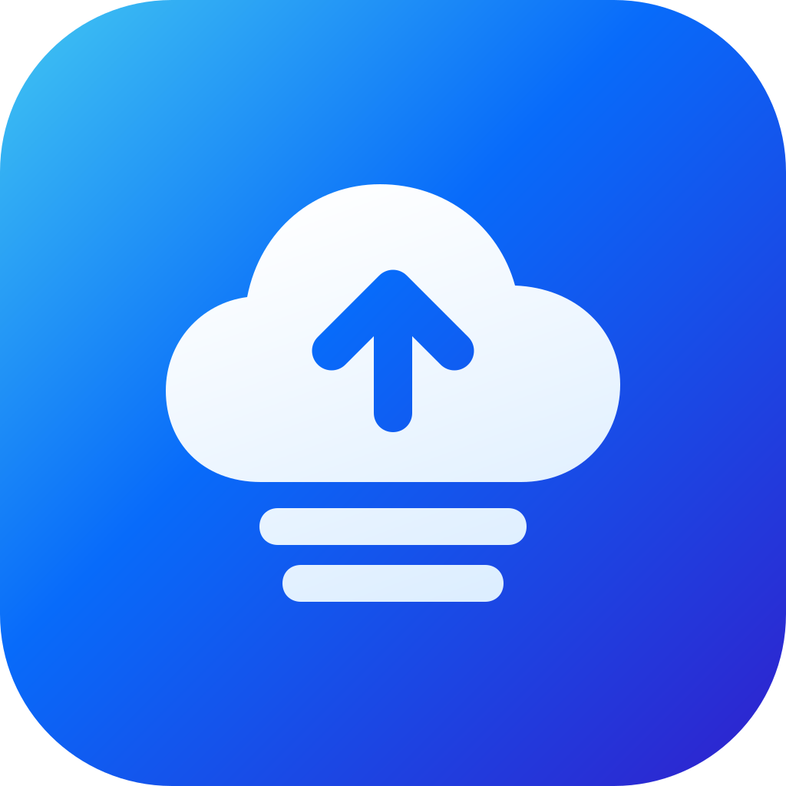

<p align="center">
  
</p>

<h1 align="center">TG Drive</h1>

<p align="center"><strong>Everything you keep, in one place.</strong></p>
<p align="center">A native Android home for your files, photos and music — stored in your own Telegram Saved Messages.</p>

<p align="center">
  <a href="https://github.com/jntynho/TG-Drive/releases/latest"></a>
  <a href="https://github.com/jntynho/TG-Drive/actions/workflows/release-no-secrets.yml"></a>
  <a href="#download"></a>
  <a href="https://github.com/jntynho/TG-Drive/releases"></a>
</p>

<p align="center">
  <a href="#download">Download</a> ·
  <a href="#features">Features</a> ·
  <a href="#getting-started">Getting started</a> ·
  <a href="#documentation">Documentation</a> ·
  <a href="https://github.com/jntynho/TG-Drive/issues">Report an issue</a>
</p>

## Download

<p align="center">
  <a href="https://github.com/jntynho/TG-Drive/releases/latest/download/tg-drive-arm64-v8a.apk"></a>
</p>
<p align="center">
  <a href="https://github.com/jntynho/TG-Drive/releases/latest/download/tg-drive-armeabi-v7a.apk"></a>
  <a href="https://github.com/jntynho/TG-Drive/releases/latest/download/tg-drive-universal.apk"></a>
</p>

| Your device | Choose |
| --- | --- |
| Most modern Android phones and tablets | **[ARM64 · arm64-v8a](https://github.com/jntynho/TG-Drive/releases/latest/download/tg-drive-arm64-v8a.apk)** |
| Older devices running a 32-bit ARM system | [ARM32 · armeabi-v7a](https://github.com/jntynho/TG-Drive/releases/latest/download/tg-drive-armeabi-v7a.apk) |
| Unsure which architecture your device supports | [Universal](https://github.com/jntynho/TG-Drive/releases/latest/download/tg-drive-universal.apk) — includes all supported architectures; larger download |

All variants require **Android 8.0 or later** and install independently. Download **one `.apk`**; no ZIP extraction or split-APK installer is needed. The buttons always target the latest published release.

<details>
<summary><strong>Intel devices, checksums and other downloads</strong></summary>

- [Intel 64-bit · x86_64](https://github.com/jntynho/TG-Drive/releases/latest/download/tg-drive-x86_64.apk)
- [Intel 32-bit · x86](https://github.com/jntynho/TG-Drive/releases/latest/download/tg-drive-x86.apk)
- [SHA-256 checksums](https://github.com/jntynho/TG-Drive/releases/latest/download/SHA256SUMS)
- [Android App Bundle](https://github.com/jntynho/TG-Drive/releases/latest/download/tg-drive.aab) — for store tooling, not direct installation
- [All releases and release notes](https://github.com/jntynho/TG-Drive/releases)

GitHub's automatic **Source code (zip/tar.gz)** downloads contain the repository, not the Android installer. Actions artifacts are also ZIP archives; use the APK assets in Releases for installation.

</details>

**Updating?** Install the new release APK over the existing release app to retain its data. The release workflow checks the existing signing identity and a signed in-place upgrade. Debug builds use a different signature; see the [release guide](docs/RELEASING.md).

## Features

<table>
  <tr>
    <td width="50%" valign="top"><strong>A home for your files</strong><br>Recent uploads, library size and file count, with folders, favorites, tags and search to keep everything organized.</td>
    <td width="50%" valign="top"><strong>A gallery for your memories</strong><br>Photo and video thumbnails, sorting, immersive image zoom and video playback, without filenames crowding the grid.</td>
  </tr>
  <tr>
    <td valign="top"><strong>Your music, together</strong><br>Songs and recordings in one place, embedded cover art when available, background playback and saved positions.</td>
    <td valign="top"><strong>Transfers you can manage</strong><br>Batch uploads, a persistent queue, pause and retry, priorities, and network and charging preferences.</td>
  </tr>
  <tr>
    <td valign="top"><strong>Ready when you are offline</strong><br>Keep selected files on the device, manage cached copies, back up selected folders and verify downloaded content with SHA-256.</td>
    <td valign="top"><strong>Privacy with a choice</strong><br>Separate Telegram profiles, device credential or biometric app lock, and optional encrypted vaults with recovery keys.</td>
  </tr>
</table>

Files also support Trash and restore, content versions, Android sharing, document/PDF previews and on-device Latin-text OCR. The interface is built with **Kotlin and Jetpack Compose**, with dark surfaces, system typography and horizontal page transitions.

### Four tabs. One library.

| Home | Gallery | Audio | Settings |
| --- | --- | --- | --- |
| Recent uploads, storage overview and shortcuts to all files and backups | Photos and videos, thumbnail grid, search and sorting | Songs and recordings, artwork and playback | Accounts, transfers, storage, library recovery and privacy |

See the [implementation details and limits](docs/IMPLEMENTATION_STATUS.md) for the broader feature inventory, and the [0.9 correction report](docs/UI-UX-0.9.ar.md) for the latest audit work and validation boundaries.

## Getting started

1. **Install an APK** matching your device from the downloads above.
2. **Connect Telegram.** If the build asks for an API ID and API hash, create your own application at [my.telegram.org/apps](https://my.telegram.org/apps). Enter these on the device, then follow Telegram's sign-in prompts. Code delivery and any additional authentication are controlled by Telegram.
3. **Add your files.** Choose files in TG Drive or share them from another Android app. Follow progress in **Activity** and browse your library through Home, Gallery or Audio.
4. **Make it yours.** Set transfer preferences, choose offline files or configure a folder backup. Keep a vault recovery key somewhere safe outside the phone if you enable a vault.

No separate storage server is needed for the main Telegram-backed library. Advanced WebDAV exports and the optional [public-copy sharing service](sharing-server/README.md) require your own endpoints.

## How it works

TG Drive uses **TDLib** to connect to your Telegram account and store file content in Saved Messages. Its library index adds folders, tags, versions and other organization on top of those messages.

Eligible ordinary single-part files carry their creation metadata in the **same Telegram message as the file**. The upload pipeline can overlap up to two ordinary content uploads while coordinating publication and account-wide cooldowns. Multipart and encrypted files retain their own handling. See the [upload pipeline](docs/UPLOAD-0.8.md).

Telegram controls connection speeds, account limits and rate limits. TG Drive cannot guarantee unlimited storage or eliminate server-requested waiting periods. Android can also defer background work.

## Privacy and data

- **Ordinary Saved Messages are not end-to-end encrypted.** App lock protects access on your device; optional vaults add client-side encryption for their content and metadata. Some metadata, including sizes and timing, remains visible.
- **Recovery matters.** Keep vault recovery credentials outside the phone. An exported library index does not restore file content deleted from Telegram.
- **Sharing creates a copy.** Sharing or exporting a vault file decrypts that copy for the destination. Revoking a public link cannot recall copies already downloaded.
- **This is experimental software.** Keep another copy of important files. Automated checks do not replace physical-device, real-account or independent security validation.

Read the [security boundaries](docs/SECURITY.md) before relying on encrypted vaults or external sharing.

## Documentation

| Guide | What you will find |
| --- | --- |
| [Feature inventory](docs/IMPLEMENTATION_STATUS.md) | Implemented capabilities and their limits |
| [Connection troubleshooting](docs/CONNECTION_TROUBLESHOOTING.md) | Telegram setup and connection diagnostics |
| [Security](docs/SECURITY.md) | Encryption, credentials, sharing and recovery boundaries |
| [Testing](docs/TESTING.md) | Checks, device coverage and remaining validation |
| [Builds and releases](docs/RELEASING.md) | APK variants, signing, CI and upgrade checks |
| [Upload pipeline](docs/UPLOAD-0.8.md) | Parallel content preparation and coordinated publication |
| [UI/UX corrections · Arabic](docs/UI-UX-0.9.ar.md) | The 0.9 audit corrections and practical limits |
| [Aero Fold artwork](docs/brand/README.md) | Editable SVG layers and adaptive Android icon sizing |

## Build from source

Use **JDK 21**, Android SDK **36**, Build Tools **36.0.0**, and the checked-in Gradle wrapper. Set `ANDROID_HOME`, or add `sdk.dir` to an ignored `local.properties` file.

```sh
git clone https://github.com/jntynho/TG-Drive.git
cd TG-Drive
./gradlew --max-workers=2 assembleDebug
```

The debug APK is written to `app/build/outputs/apk/debug/app-debug.apk`.

<details>
<summary><strong>Validation, release builds and Telegram application credentials</strong></summary>

```sh
./gradlew --max-workers=2 testDebugUnitTest lintDebug assembleDebugAndroidTest
./gradlew --max-workers=2 testReleaseUnitTest lintRelease assembleRelease -PsplitApks=true
./gradlew --max-workers=2 bundleRelease -PbundleOnly=true
npm test --prefix sharing-server
python3 scripts/generate_launcher.py --check
```

The optional sharing-service tests require Node.js 24. Native Android device tests additionally need a connected device or emulator; see [Testing](docs/TESTING.md).

A distributor may supply authorized `TELEGRAM_API_ID` and `TELEGRAM_API_HASH` through environment settings or ignored `local.properties`; users can then begin with their phone number. Embedded application identifiers are extractable. Never commit user sessions, login codes, passwords or signing keys.

Local release outputs are unsigned unless the existing signing configuration is supplied. The GitHub workflow verifies device tests, release unit/lint checks, matching APK payloads, signature/alignment and a signed upgrade before publishing installable assets. It does not upload to Google Play.

</details>

## Contributing

[Report a bug](https://github.com/jntynho/TG-Drive/issues) with your app version, Android version, device architecture and steps to reproduce. Remove phone numbers, login codes, API credentials and private file details from reports and screenshots.

For code contributions, keep changes focused and run the checks relevant to the change. See [Testing](docs/TESTING.md) for the full validation guide.

## Acknowledgements

Built with [TDLib](https://github.com/tdlib/td), [Jetpack Compose](https://developer.android.com/compose), [Media3](https://developer.android.com/media/media3) and [Tink](https://github.com/tink-crypto/tink). Interface icons use [Lucide](https://lucide.dev); vendored source and its license are in [third_party/lucide](third_party/lucide).

TG Drive is an independent project and is not affiliated with Telegram.
